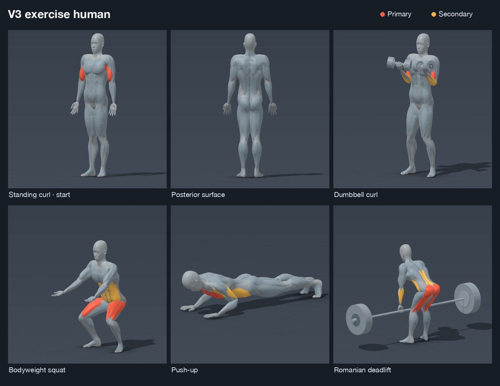

# V3 exercise human

[Try the local interactive model](http://127.0.0.1:8766/?id=bodyweight-squat) · [Open the editable Blender master](ExerciseHuman.blend) · [See V3 inside Simple Trainer](Review/simple-trainer.jpg)



## Launch

Run `python3 V3/preview.py` from the repository root, with the sibling EML checkout and its Python environment prepared. The launcher serves the V3 buffers and EML's browser viewer on port 8766. Pass `--eml /path/to/eml` or `--port 8767` to choose another checkout or port. Select an exercise and press **Play**. Drag to orbit or use the timeline to inspect the motion.

For iOS, build the **HumanExerciseModels** scheme. The Xcode staging phase places this branch’s four anatomy files in the embedded EML tree and checks the joint profile, muscle vocabulary and buffer sizes. Use **Exercises → Create custom EML** to build a movement or **Load EML** to play an existing recipe. [Native build instructions](../README.md#build-and-run)

## Author a chained exercise

Use EML’s `codex/eml-fluent-recipe` branch. The tested revision is `2d157ff9273159676803fe86d638af2821a3ad85`. With the sibling checkout at that revision, prepare its Python environment once from this repository root. [Checkout instructions](../README.md#build-and-run) · [Upstream Python API](https://github.com/agrim/exercise-markup-language/blob/2d157ff9273159676803fe86d638af2821a3ad85/docs/python-api.md)

```sh
python3 -m venv ../eml/.venv
../eml/.venv/bin/python -m pip install -r ../eml/requirements.txt
python3 V3/preview.py --recipe V3/Examples/squat_and_curl.py
```

Open the URL printed by the launcher. Scrub from **Squat** to **Curl** to see the elbows flex while the legs hold their depth. The highlight moves from the quadriceps and glutes to the biceps. The **Depth** control changes the squat depth across the whole sequence. [Playable example](http://127.0.0.1:8766/?id=squat-and-curl) · [Recipe source](Examples/squat_and_curl.py) · [Curl phase with muscle highlights](Review/chained-squat-and-curl.jpg)

To author your own, copy the Python example and have `recipe()` return an `eml.Recipe`. Each `.move()` adds a timed endpoint. Chain `.action()` calls on one phase for simultaneous movements, and use `.muscles(..., phase=True)` to change the primary and secondary groups during that phase. Rerun the launcher after editing. The local launcher runs the selected Python file and validates its movement against the V3 rig before serving or exporting it.

```sh
python3 V3/preview.py --recipe V3/Examples/squat_and_curl.py --export my-exercise.json
```

The export is an EML 1.1 recipe that carries the movements, parameters, repetitions and muscle roles. In Exercise Studio, use **Exercises → Load EML → Open → Choose file**, then **Preview** or **Save and play**. The **Squat and curl** entry in the same menu opens the bundled export. Simple Trainer’s custom exercise player accepts the same JSON. [Portable example](Examples/squat-and-curl.json)

For a supported movement with equipment, pass `--recipe ../eml/examples/fluent_incline_push_up.py` to the same launcher. The upstream chain specifies palm and toe contacts, raised pads and four timed phases. A local recipe that reuses a catalog ID takes its place for that preview session.

## Surface and rig

The source body uses MakeHuman’s MPFB base, bilateral arm and leg muscle targets, and torso shape controls. It includes individual fingers and toes. The upstream game-engine weights and joint helpers provide the initial correspondence. V3 registers the body to EML, constructs a Blender armature and transfers the weights into that armature’s 51-joint hierarchy. The final shoulder weights are smoothed along connected mesh edges, including the underarm and upper rib cage. [Pinned MPFB art](https://github.com/makehumancommunity/mpfb2/tree/9de0707fdc88438d7c53a1a2ac7937d9221e2431/src/mpfb/data) · [Asset credits](../Revision/Sources/ExerciseDummy/Resources/ATTRIBUTION.md)

The source selection also considered Blender Studio’s realistic male base mesh and Quaternius’s rigged base characters. MPFB supplied the anatomical landmarks, redistributable phenotype targets and indexed finger weights used in this build. [Blender Studio base mesh](https://studio.blender.org/training/realistic-human-research/use-of-base-meshes/) · [Quaternius Universal Base Characters](https://quaternius.com/packs/universalbasecharacters)

The 28 exercise muscle groups are regions of one continuous body surface. Separate bellies within the quadriceps, hamstrings, calves and abdominal wall have their own contours. Deeper groups such as the rotator cuff have a surface projection. Per-face material names match EML group IDs. The Metal renderer assigns the primary and secondary colors at playback, including changes authored for an individual phase. Rest-space shading follows the skin through a pose.

## Edit and export

Open the master in Blender **5.2.1 LTS**. Edit the surface or muscle material assignments on **V3 • Anatomy**. Use Weight Paint to adjust a joint’s influence and Pose Mode on **V3 • EML skeleton** to inspect the bend. The armature stores the EML bind profile. The exporter evaluates the mesh in its rest pose and checks the profile’s pivots and bone parents.

From the repository root, export an edited master with the following commands.

```sh
BLENDER=/Applications/Blender.app/Contents/MacOS/Blender
RUNTIME=Revision/Sources/ExerciseDummy/Resources
"$BLENDER" -b --disable-autoexec V3/ExerciseHuman.blend --python-exit-code 1 \
  --python V3/Authoring/export.py -- "$RUNTIME"
```

To regenerate the master from the published base, fetch the pinned CC0 art inputs and write a separate Blender file and export directory. The generator uses the reference manifest’s joints, contact landmarks, grip bindings and muscle names. All surface geometry comes from the fitted MPFB body and the V3 contour definitions.

```sh
WORK=$(mktemp -d)
python3 V3/Authoring/fetch_base.py "$WORK/art"
"$BLENDER" -b --factory-startup --disable-autoexec --python-exit-code 1 \
  --python V3/Authoring/build.py -- "$WORK/art" ../eml "$WORK/ExerciseHuman.blend" "$WORK/anatomy"
```

The contour definitions and shape controls can be edited independently. The exporter emits `model.json`, `vertices.bin` and `indices.bin`. Distribute the bundled `ATTRIBUTION.md` with them. [Muscle contours](Authoring/regions.py) · [Body fitting and skin weights](Authoring/base.py) · [Shape targets](Authoring/fetch_base.py)

## Simple Trainer integration

Simple Trainer already constructs an `ExercisePlayer` from a compiled EML clip and embeds its Metal view in **About Exercise**. V3 uses the same API. In a vendor update, take the four anatomy files from `Revision/Sources/ExerciseDummy/Resources` into the host’s `Vendor/EML/Standard/anatomy`. Use this branch’s Metal shader for muscle fiber shading and the V3 shell color in `Renderer.swift`. Retain the app’s camera, gesture and diagnostic patches when updating its vendor pin. [Runtime files](../Revision/Sources/ExerciseDummy/Resources) · [Metal shader](../Revision/Sources/ExerciseDummy/Shaders/ExerciseDummy.metal)

An isolated copy of Simple Trainer at `0ef7ee9` was used for the integration check. Its existing exercise screen rendered V3 inside the native form. The camera test selected the Roll Out pose, orbited, pinched to zoom, reset the view, toggled playback and opened muscle details and model credits. [Simulator capture](Review/simple-trainer.jpg)

## Measurements

| Body asset | Previous EML atlas | V3 |
| --- | ---: | ---: |
| Indexed triangles | 222,579 | 31,637 |
| Runtime vertices | 113,681 | 22,772 |
| Vertex and index buffers | 7,218,188 bytes | 1,290,524 bytes |

The existing offscreen Metal benchmark rendered 21 poses per exercise at 960 × 1200 on an Apple M5. These are GPU command-buffer times for the median measured frame, excluding presentation and readback. Physical-iPhone frame pacing and sustained power use still need measurement.

| Exercise | Previous GPU time | V3 GPU time |
| --- | ---: | ---: |
| Squat | 2.29 ms | 0.47 ms |
| Bench press | 1.39 ms | 0.25 ms |
| Push-up | 1.24 ms | 0.18 ms |
| Kettlebell swing | 1.29 ms | 0.20 ms |
| Leg press | 1.35 ms | 0.21 ms |

Both a clean rebuild from the pinned assets and a headless export from the saved Blender file reproduced all three runtime files byte for byte. In the rest pose, the heel and forefoot landmarks lie within 3.3 mm of the mesh, and both palm landmarks within 2.3 mm. The Mac package compared native motion transforms with EML across 108 catalog exercises and three custom exercises. Exercise Studio’s iOS tests exercised the offline compiler, rendering and editable custom EML.

A sampled deformation check tracked triangle edges longer than 4 mm through five exercises. The most pronounced local stretching was at the underarm in the overhead press and the toe joint in the push-up. These areas merit physical-device visual review at close zoom.
